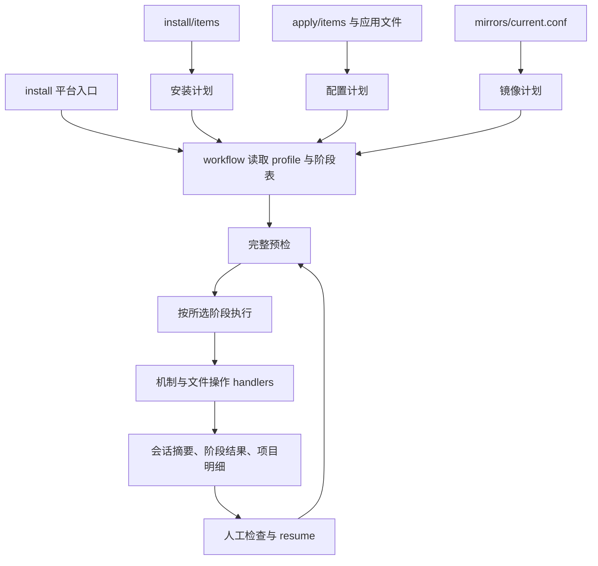

# 架构与能力边界

本项目是可多次手动启动、每次独立运行的无人值守安装器与配置管理工具。无人值守指已满足前提后的顺序执行，不保证消除所有外部程序的授权、GUI 或重启要求；遇到这些条件可以失败或延后，由用户处理后再运行。

## 目录与职责

| 路径 | 职责 | 主要维护入口 |
| --- | --- | --- |
| `install/` | 平台 CLI、安装项声明、安装机制 | `items/*.conf`、`schema/*.tsv`、`handlers/` |
| `apply/` | 配置文件部署与受保护恢复 | `items/*.conf`、`schema/fields.tsv`、`handlers/` |
| `workflow/` | 安装与配置的阶段关联、状态查询 | `profiles/*.conf`、`schema/stages.tsv`、`status.*` |
| `mirrors/` | 当前镜像端点与历史所有权数据 | `current.conf`、`legacy.conf` |
| `contracts/` | 核心与原生适配器共用的版本化数据格式 | `schema/types.tsv`、`schema/*.fields` |
| `dotfiles_core/` | 共享声明、规划、预检、调度、镜像与报告规则 | 标准库 Python 模块 |
| `lib/` | 原生观察、命令、事务、恢复、租约和核心薄包装 | 对应的 `.sh` / `.ps1` 模块 |
| `configs/fish/`、`configs/helix/`、`configs/wezterm/`、`configs/zellij/`、`configs/git/` | Unix 应用配置源文件 | 各应用原生格式 |
| `configs/windows-terminal/` | Windows Terminal 配置源文件 | `settings.json`，允许 JSONC 注释 |
| `tests/`、`.github/workflows/` | 共享夹具、隔离回归和已禁用的平台 CI 配置 | `checks/manifest.tsv` |

`configs/` 的边界是被管理应用的配置内容，不是安装器自身的控制配置集合。其子目录不会被自动扫描部署，也不直接对应目标目录树；部署关系由 `apply/items/` 声明。详见 [目录用途](../configs/README.md)。

## 数据流

`desktop-fonts` 在原生 KDE 中读取当前 KDE/GTK 设置，在调用者管理的临时目录渲染候选文件，复用 apply 的复制、备份和恢复；Fontconfig 规则保存在 `configs/fontconfig/` 并硬链接部署；同一 XML 声明驱动桌面字体 family 和缺失字体预检，不在处理器中固定字体名称。

独立 apply 入口直接生成文件计划并执行，不经过软件安装阶段。镜像模块生成同一种 apply 文件计划，复用文件事务、备份和报告逻辑。

`workflow-context.sh` / Windows hashtable 保存显式运行上下文；平台操作在 `workflow-unix.sh` / `workflow-windows.ps1` 中。入口仅负责参数和主机检测。Bash 保持 3.2 兼容，PowerShell 保持 5.1 兼容。

## 当前保证

| 方面 | 当前能力 | 不能据此推断 |
| --- | --- | --- |
| 声明检查 | 校验字段、平台、来源、依赖和关联 | 包必定存在、远程下载永远可用 |
| 安装顺序 | 依赖优先，再按数字 order 和 ID 排序 | 锁定软件版本或重放完整环境 |
| 预检 | 所选阶段在变更前检查前提，执行时重新检查必要状态 | 外部状态在整个安装期间保持不变 |
| 文件部署 | 硬链接或复制，冲突备份，正确目标跳过 | 未托管目录会被同步删除 |
| 恢复 | 当前文件操作失败时尝试恢复；journal 支持受保护的显式恢复 | 跨包管理器、Git 设置和登录 shell 的全局事务 |
| 续跑 | 人工选择旧会话，创建新会话，重新探测安装项 | exactly-once、自动重试、旧计划重放 |
| 报告 | 单个文件原子替换、显式结构化产物路径 | 多文件原子提交或断电持久性 |
| 并发 | 同一用户且使用同一锁路径的工作流互斥，子流程继承所有权 | 排除其他用户、外部包管理器或手动编辑 |
| 进程 | 参数数组、输出捕获、超时和取消接口 | 可靠控制脱离进程树的程序或强杀后的 WSL guest |

## 明确非目标

不继续扩展环境可复现性、版本锁定、回滚范围、强制打断可靠性、崩溃/断电持久性或服务健康检查。能力声明 `provides` 只描述安装所有权，不能用于要求 daemon、容器或网络服务运行。

已有保障需要维护，不能借范围收缩删除备份或绕过锁。进程非正常退出后不自动抢占遗留锁；父进程消失不证明所有子进程都已停止。计划中的镜像临时文件只属于当前调用，保存计划不是执行接口。

## 演进与交付

新增软件优先新增声明；新增文件映射优先新增 apply 项；复用现有机制。只有当前 schema/handler 无法表达真实需求时才扩展实现，并同时更新两端契约与相关测试。

交付检查关注声明可解析、安装/配置流程、失败传播、人工续跑、文档和相关平台回归。不要把范围外的服务健康或更强恢复保证增加为交付条件。CI 配置存在不等于当前提交的 CI 已通过，见 [验证文档](../tests/README.md)。

### 安装状态与动作决策

`lib/install-items.*` 保留原生调用接口；`dotfiles_core/install_config.py` 统一解析、兼容转换和依赖图，`install_planning.py` 与 `execution_rules.py` 统一选择和决策。`native_observation.py` 通过原生适配器获取文件系统与命令观察，`install_execution.py` 调度安装项和报告。handlers 仍负责实际平台命令。

普通规划和人工续跑共用决策层。续跑仍重新探测当前状态，不依据历史成功报告跳过安装。
普通运行与续跑均使用当前安装清单，已存在的 pipx 环境也跳过。安装命令按执行策略正常退出即成功，不进行安装后存在性复核；续跑仍保留阶段选择语义。

安装计划保留观察到的匹配方式和路径，`dotfiles_core/contracts.py` 集中构造执行结果、读取旧 v1
结果和格式化状态说明。发现引擎一次检查同时返回状态与路径，报告发布不重新探测。
执行阶段仍使用原有原子快照；这些证据描述检查时刻的文件系统，不扩展为安装后验证、事务或健康检查。

当前运行先验证完整声明图，再从 profile 根项目开始观察并按需扩展依赖。公共依赖始终保留，安装专用边只在目标需要安装时扩展；离线计划不做发现，展示首选方式的完整依赖图。准备操作按当前待安装机制触发。普通重跑重新规划当前选择，手动续跑仍只处理原会话所选阶段中的未完成部分，不成为全量巡检。

## Python 与原生边界

启动器仅使用显式 `DOTFILES_PYTHON` 或当前 checkout 的平台 `.venv`，要求 Python ≥3.15；验证使用 3.15。帮助不要求运行时，plan、dry-run、resume、restore 都要求。初始化固定解释器，保留虚拟环境路径；Windows 解释器不传给 WSL，guest 独立准备运行时。

`workflow_preflight.py` 协调完整只读预检，`workflow_session.py` 管理会话与阶段循环，`workflow_review.py` 解释历史结果及人工续跑。profile v2、install-plan v7、workflow-request v2 保持不变；空集合不部署，续跑读取当前声明并重新观察。配置规划接收显式根映射，仅解析所选组件的根；home 不作为整个会话禁区，具体托管目标仍受保护。

核心与 `lib/core-adapter.*` 使用当前调用私有目录中的 UTF-8 JSON 请求/结果，校验版本、字段、允许操作、操作匹配和退出码。大结构不放入外部命令 argv，不从日志推断结构化结果。文件不会成为持久计划或重放接口。

原生侧保留主机、文件系统、账户、WSL 查询及终端输入、日志、超时、取消；文件事务、journal 和受保护恢复保持完整原生操作，部署租约覆盖完整变更区间，报告由原生原子发布。没有旧业务实现回退开关。
